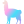

# Hi, I'm Hung-Ta Chen 👋

  

## About Me

- 💼 Software Development Engineer at **Amazon** (Seller Fees, Seattle), building an LLM fee explainer and an AI fee agent for sellers
- 🎓 M.S. in Statistics (Data Science) from UC Davis
- 🚀 Into LLM systems, agents, and the cloud infrastructure behind them
- 🌐 More on my work at [hungtachen.com](https://hungtachen.com)

## Tech Stack

  
  
  
  
  
  
  
  
  
  
  
  

  
  
  <a href="https://platform.openai.com/" target="_blank" rel="noreferrer">
    <picture>
      <source media="(prefers-color-scheme: dark)" srcset="https://raw.githubusercontent.com/Hung-Ta-Chen/Hung-Ta-Chen/main/assets/openai-dark.svg">
      
    </picture>
  </a>
  

## Let's Connect

  
  
  
  

